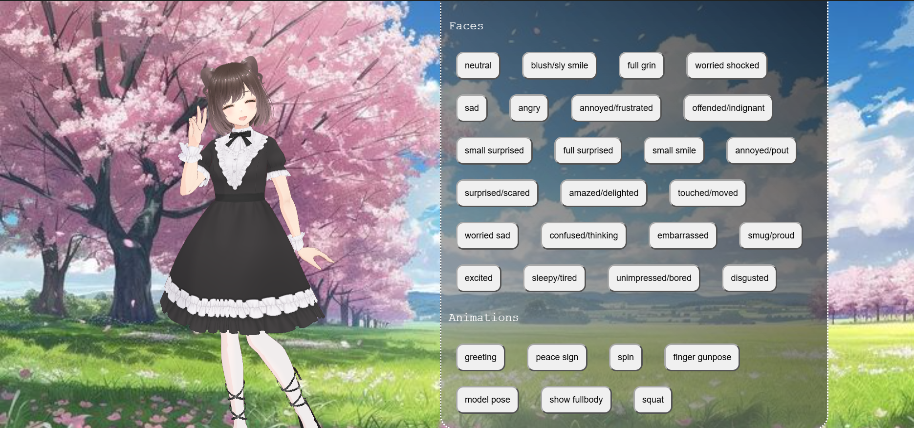

# 🐱 Nyann — 3D VRM Face & Animation Playground

A playground for testing and switching characters, backgrounds, facial expressions, and free sample animations on my VRoid model, Nyann. Made simply for fun, for experimenting, and for my younger sister to try.

🔗 **Live demo:** https://lianeraizelroga-lgtm.github.io/3D-AnimeGirl/botAI.html

## ✨ Features
- **23 facial expressions** blended from the 5 base VRM expressions (happy, sad, angry, relaxed, surprised)
- **7 animations:** greeting, peace sign, spin, finger gun pose, model pose, show full body, squat
- **Avatar toggle:** switch between girl Nyann and boy Nyann
- **Background toggle:** day and night Tokyo street
- **Idle motion:** automatic blinking, breathing, and a slow sway

## 🛠️ Built with
- [Three.js](https://threejs.org/)
- [@pixiv/three-vrm](https://github.com/pixiv/three-vrm) and three-vrm-animation
- [VRoid Studio](https://vroid.com/en/studio) for the models

## ▶️ Run locally
This project uses ES modules, so opening `botAI.html` directly won't work.
Use a local server instead, like the **Live Server** extension in VS Code.

## 🗺️ Roadmap
- [ ] AI chat where Nyann changes her own expressions, animations, and background based on the conversation

## 📅 History
- **October 28, 2026:** facial expressions and the 7 animations
- **November 24, 2026:** avatar and background switching

## 🙏 Credits
- Animations: free sample animations from VRoid
- Backgrounds: *(add the original artist/source here)*
